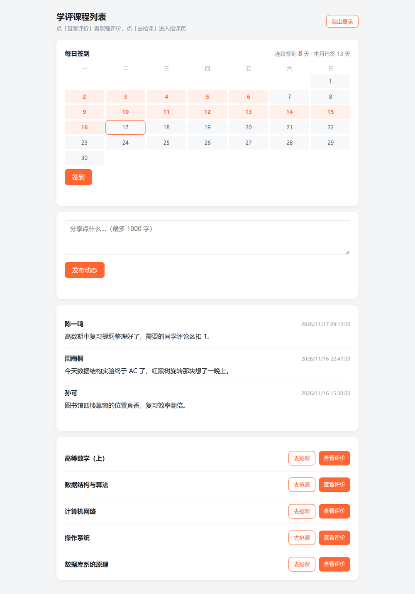
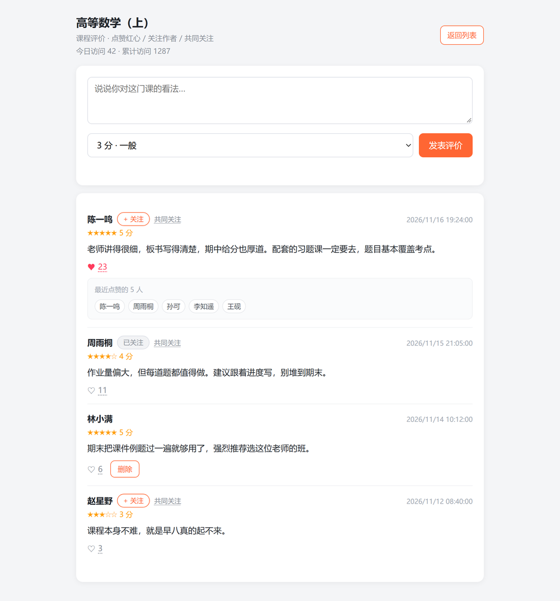
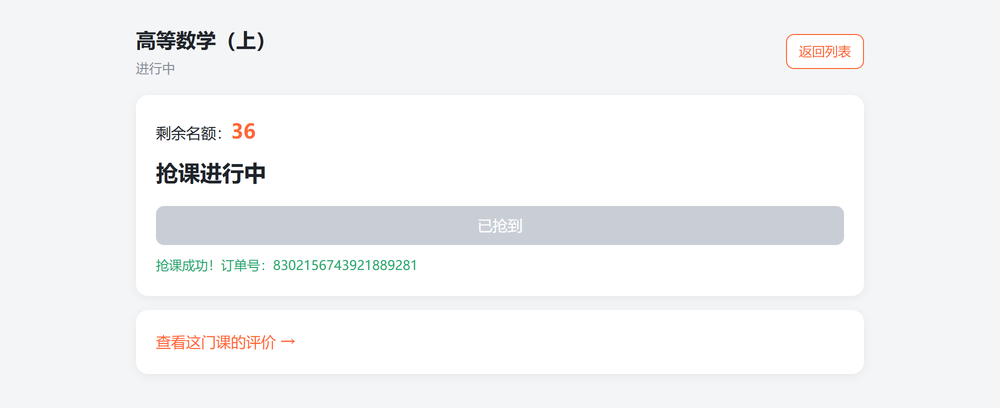
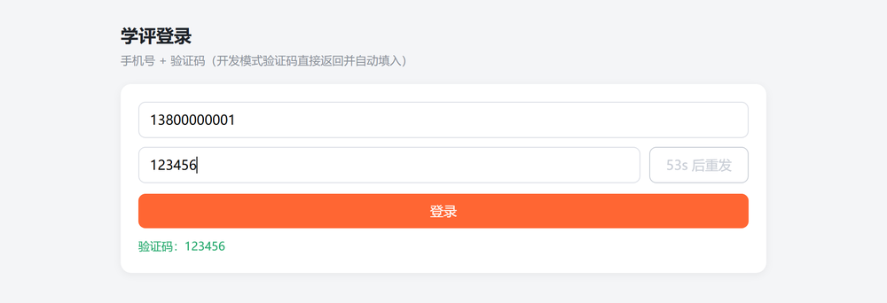

# 学评 XuePing · 校园课程评价与选课平台

面向高校学生的课程评价与选课系统：课程浏览、评价与点赞、关注动态、每日签到、限时抢课。
重点解决选课开放瞬间的瞬时高并发——名额有限、一人一单、不能超卖，也不能让流量直接打穿数据库。

后端 .NET 10 + ASP.NET Core，四层架构；抢课链路为 **Redis Lua 原子预扣 → 消息队列异步下单 → 消费者幂等落库 → 前端轮询结果**。


## 功能预览

| 课程列表 · 每日签到 · 关注动态 | 课程评价 · 点赞榜 · 关注 |
| --- | --- |
|  |  |

| 抢课（异步下单 + 轮询结果） | 登录（手机号 + 验证码） |
| --- | --- |
|  |  |

> 截图为演示数据，仅用于展示界面效果。

## 技术栈

| 分类 | 选型 |
| --- | --- |
| 语言 / 框架 | C#、.NET 10、ASP.NET Core Web API |
| 持久化 | EF Core 10（Code First + Migrations）、SQL Server |
| 缓存 / 数据结构 | Redis：String、Hash、Set、ZSet、Bitmap、HyperLogLog、Stream、Lua |
| 消息队列 | Redis Stream（默认）/ RabbitMQ（RabbitMQ.Client 7.x，DLX + TTL 重试） |
| 认证 | JWT Bearer + Redis 登录态白名单（滑动续期、强制下线） |
| 日志 / 文档 | Serilog（控制台 + 按天滚动的文件）、Swagger / OpenAPI |
| 前端 | 原生 HTML + CSS + JavaScript（无构建链路） |

## 架构

```
XuePing.sln
├─ XuePing.Api/            表现层：Controller、JWT 认证管道、全局异常中间件、后台 Worker、Swagger
├─ XuePing.Application/    应用层：DTO + 按用例拆分的 Service（一接口一实现），统一 Result<T>
├─ XuePing.Domain/         领域层：实体、值对象、基础设施抽象接口（不依赖任何实现）
├─ XuePing.Infrastructure/ 基础设施层：EF Core、Redis 实现、RabbitMQ、JWT 签发
├─ frontend/               静态前端：登录 / 课程列表 / 课程评价 / 抢课
└─ docs/screenshots/       README 截图
```

依赖方向单向向内：`Api → Application → Domain`，`Infrastructure` 实现 `Domain` 的抽象，由 DI 在启动时装配。

## 核心实现

**抢课主链路（本项目重点）**

- **原子预扣**：用 Lua 把「查库存、判一人一单、扣减、记录用户」合并成一次 Redis 原子操作，返回 `0 售罄 / 1 成功 / 2 重复`，从根上消除超卖与一人多单（`RedisSeckillStockService`）。
- **异步下单**：预扣成功只负责入队，接口立即返回「排队中」，前端 500ms 轮询状态（`SelectCourseService` / `SeckillOrderConsummerService`）。
- **幂等落库**：消费者先查 `CourseSelections` 再插入，数据库唯一索引兜底；重复消息直接 ACK（`SeckillOrderHandler`）。
- **可靠性**：Stream 消费者组 + Pending 重投 + `XAUTOCLAIM` 接管宕机消费者闲置消息，重试超 3 次转死信并回写失败状态；RabbitMQ 路径使用持久化队列、手动 ACK、`x-death` 计数与 DLX 重试（`RabbitSeckillOrderConsumer` / `RabbitOrderTopology`）。
- **可切换的消息实现**：`MessageBus:Provider` 在 `RedisStream` 与 `RabbitMQ` 之间切换，二者实现同一组 `ISeckillOrderPublisher` / `ISeckillOrderConsumer` 抽象。

**缓存治理（课程详情）**

- 逻辑过期（业务过期时间 + 随机物理 TTL）+ 空值缓存防穿透 + `SETNX` 分布式锁异步重建，未命中时先返回过期数据再后台刷新。
- UV 用 HyperLogLog 统计日/总访问量；连续签到用 Bitmap + `BITFIELD` 位运算，支持月度日历与连续天数。

**登录态**

- 手机验证码登录（Redis TTL），JWT 签发；在 `JwtBearerEvents.OnTokenValidated` 中比对 Redis 中的 token，实现服务端可控的强制下线与滑动续期。
- 全局 `FallbackPolicy` 默认要求鉴权，新增接口默认受保护。

**社区**

- 关注/粉丝用 Set 维护，`SINTER` 求共同关注；发动态写扩散到粉丝收件箱 ZSet 并裁剪至最近 1000 条，按 `score` 做游标分页，避免同一时间戳翻页重复。

## 快速开始

### 1. 环境要求

- .NET 10 SDK
- SQL Server（本机实例即可，连接串用 `Trusted_Connection`）
- Redis 7.x（Windows 可用 WSL / Docker / 虚拟机）
- 可选：RabbitMQ 3.x+（仅在 `MessageBus:Provider=RabbitMQ` 时需要）

### 2. 准备配置

真实连接串不要提交到仓库。复制模板后填入自己的值：

```bash
cp XuePing.Api/appsettings.Example.json XuePing.Api/appsettings.Local.json
```

`appsettings.Local.json` 已被 `.gitignore` 排除，启动时由 `Program.cs` 自动加载（存在才加载），优先级高于 `appsettings.json`。
也可以完全不用该文件，改用环境变量覆盖（见下表）。

### 3. 建库并启动

```bash
dotnet restore
dotnet ef database update --project XuePing.Infrastructure --startup-project XuePing.Api
dotnet run --project XuePing.Api
```

- Swagger：<http://localhost:5242/swagger>
- 开发模式下验证码不发送短信，直接由 `POST /api/User/code` 返回并自动填入登录页。

### 4. 启动前端

前端是纯静态页面，用任意静态服务器托管在 5500 端口即可（后端 CORS 已放行 `127.0.0.1:5500` / `localhost:5500`）：

```bash
cd frontend
python -m http.server 5500
```

打开 <http://127.0.0.1:5500/login.html>。页面里的 API 地址固定为 `http://127.0.0.1:5242`，改端口时同步修改 `frontend/*.html` 顶部的 `const API`。

## 配置项

| 配置键 | 说明 | 环境变量 |
| --- | --- | --- |
| `Jwt:Key` | HS256 签名密钥，至少 32 字符，**生产必须替换** | `Jwt__Key` |
| `Jwt:ExpireMinutes` | token 有效期（分钟），同时用作 Redis 登录态 TTL | `Jwt__ExpireMinutes` |
| `ConnectionStrings:Default` | SQL Server 连接串 | `ConnectionStrings__Default` |
| `ConnectionStrings:Redis` | StackExchange.Redis 连接串（可带 `password=`） | `ConnectionStrings__Redis` |
| `MessageBus:Provider` | `RedisStream`（默认）或 `RabbitMQ` | `MessageBus__Provider` |
| `MessageBus:HostName` / `Port` / `UserName` / `VirtualHost` | RabbitMQ 连接信息 | `MessageBus__HostName` 等 |
| `RABBIT_PASS` | RabbitMQ 密码，代码只从环境变量读取，不落配置文件 | `RABBIT_PASS` |

## 接口一览

| 模块 | 方法与路径 | 说明 |
| --- | --- | --- |
| 登录 | `POST /api/User/code` | 获取验证码（开发模式直接返回） |
| 登录 | `POST /api/User/login` | 手机号 + 验证码登录，返回 JWT |
| 课程 | `GET /api/Course` | 课程列表 |
| 课程 | `GET /api/Course/{id}` | 课程详情（逻辑过期缓存） |
| 课程 | `POST/PUT/DELETE /api/Course...` | 新增 / 修改 / 删除 |
| 课程 | `GET /api/Course/{id}/uv` | 日 UV / 总 UV（HyperLogLog） |
| 评价 | `POST /api/Review`、`DELETE /api/Review/{id}` | 发表 / 删除评价 |
| 评价 | `GET /api/Review/course/{courseId}` | 课程评价列表（含点赞状态） |
| 点赞 | `POST/DELETE /api/ReviewLike/{reviewId}` | 点赞 / 取消点赞 |
| 点赞 | `GET /api/ReviewLike/top/{reviewId}?count=5` | 最近点赞的人（ZSet） |
| 关注 | `POST/DELETE /api/Follow/{userId}` | 关注 / 取关 |
| 关注 | `GET /api/Follow/isfollow/{userId}`、`GET /api/Follow/common/{otherUserId}` | 是否关注 / 共同关注 |
| 签到 | `POST /api/Sign`、`GET /api/Sign/status` | 签到 / 签到状态与日历 |
| 动态 | `POST /api/Feed`、`GET /api/Feed?count=5` | 发布动态 / Feed 游标分页 |
| 抢课 | `POST /api/CourseSelection/quota/{courseId}` | 名额与时间窗 |
| 抢课 | `POST /api/CourseSelection/{courseId}` | 抢课（Lua 预扣 + 入队） |
| 抢课 | `GET /api/CourseSelection/status/{courseId}` | 抢课结果轮询 |

仓库内附 `XuePing.Api/XuePing.Api.http`，可直接在 Visual Studio / VS Code REST Client 里按顺序调用。

## 数据模型

8 张业务表由 EF Core Code First 管理，共 5 次迁移：

`Users`、`Courses`、`CourseCategories`、`CourseSelections`、`SeckillQuotas`、`Reviews`、`Follows`、`Posts`。
`CourseSelections` 上有 `(UserId, CourseId)` 唯一索引，作为一人一单的最后一道防线。

## 已知限制与后续计划

- 前端为原生 HTML/JS，暂无构建链路与组件化；后续可能换成 Vue/React。
- 暂无自动化测试与 CI，抢课逻辑目前靠手工压测与接口验收。
- 抢课状态保存在 Redis（带 TTL），过期后需回源数据库查询。
- RabbitMQ 链路默认关闭，需自行准备 broker 并设置 `RABBIT_PASS`。
- 计划补充：JMeter 压测数据与零超卖验证报告、核心链路单元测试、Docker Compose 一键起环境。

## 说明

本项目以「黑马点评」的 Redis 应用场景为学习蓝本，业务侧改造为校园课程评价与选课系统，代码为独立实现，用于学习高并发场景下的缓存、消息队列与一致性设计。
